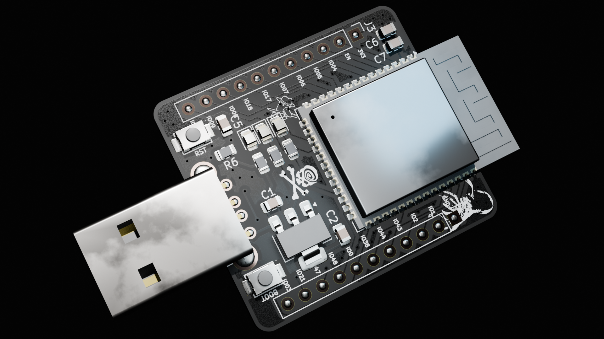
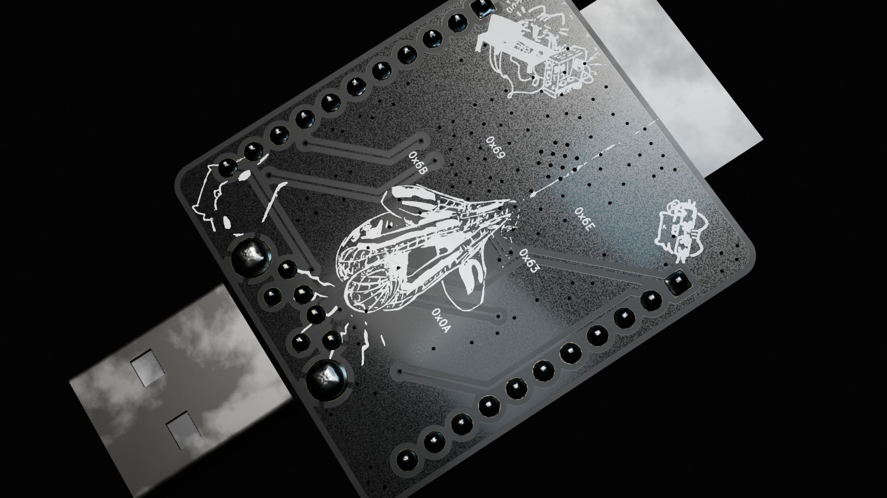

# S3 Ducky

A pocket-sized USB HID injection tool built on the ESP32-S3's native USB peripheral — no separate USB-serial or "Digispark"-style bootloader chip needed. Plug it in, and it enumerates as a keyboard.

> **NOTE: Firmware is not tested.**

 
*(Add renders or photos of the front/back PCB here — e.g. exported from KiCad's 3D viewer or your fab's preview.)*

## Why I built this

I had no experience in making devboards from esp32 dev modules so this is the best practical project i could think of aside from making a simple devboard

## Features

- **Native USB HID keyboard** — the ESP32-S3's built-in USB-OTG peripheral emulates a keyboard directly; no USB-to-serial bridge or second MCU in the path.
- **ESP32-S3-WROOM-1 module** — also brings Wi-Fi and BLE on board for future expansion (e.g. wireless trigger, exfil, or OTA payload updates).
- **Single-button payload trigger** — a press on the BOOT button (GPIO0) fires the macro in `triggerMacro()`.
- **Two onboard push buttons (SW1, SW2)** — serve as the BOOT (GPIO0) and EN/RESET buttons needed to manually enter flashing mode
- **Status LEDs** — onboard red, green and blue 0805 LEDs (D1–D3) for state/feedback.
- **Two 11-pin headers (J1, J3)** — breakout for spare GPIO.
- **Compact 2-layer PCB** — roughly 33 × 37 mm, SMD passives throughout.
- **USB-A male, through-hole** — plugs straight into a host port like a standard USB drive/dongle; no cable needed.

## How it works

The ESP32-S3 has a native USB-OTG peripheral, so it can act as a USB HID device entirely in firmware (via the Arduino `USBHIDKeyboard` library) — the chip itself is the keyboard, nothing is emulated over serial.

On boot, the firmware initializes the keyboard HID driver and the USB peripheral. The main loop watches the BOOT button (GPIO0, debounced) for a press. On a press, `triggerMacro()` sends a scripted sequence of keystrokes to whatever host the board is plugged into — the included example opens the Windows Run dialog (`GUI + R`), launches Notepad, and types a short message, release-all-keys between each step to avoid stuck inputs.

## Flashing

1. Install the ESP32 board package in Arduino IDE (or PlatformIO) and select **ESP32S3 Dev Module**.
2. Under **Tools**, set:
   - **USB Mode:** `USB-OTG (TinyUSB)` — required for native HID.
   - **USB CDC On Boot:** as needed for your debug setup.
3. If the board doesn't auto-enter the bootloader (no auto-reset circuit on this design), hold **SW1 (BOOT)**, tap **SW2 (RESET)**, then release SW1 to enter download mode.
4. Select the correct COM/serial port and upload `HID_firmware.ino`.
5. Reset the board and confirm it enumerates on the host as a USB keyboard before relying on it.

## Repo contents

| File | Description |
|---|---|
| `s3-ducky.kicad_pro` / `.kicad_sch` / `.kicad_pcb` | KiCad 9 project, schematic and PCB layout |
| `s3-ducky-*.gbr`, `*.drl`, `*.gbrjob` | Fabrication Gerbers / drill files / job file |
| `s3duckygerber.zip` | Zipped Gerber set, ready to send to a fab |
| `HID_firmware.ino` | Arduino sketch — native USB HID keyboard + button-triggered macro |
| `BOMS3DUCKY.csv` | Sourced bill of materials (see below) |

## Bill of Materials

Prices below are what I found while sourcing parts for a single board, mostly from Indian component shops (Robu, Quartz Components, Sharvi Electronics). `Unsourced` rows weren't matched to a confirmed listing — check stock/pricing yourself before ordering.

| # | Reference | Part | Footprint | Qty | Vendor | Product | Price (₹) | Price ($) |
|---|---|---|---|---|---|---|---|---|
| 1 | C1, C7 | 100nF | `Capacitor_SMD:C_0805_2012Metric` | 2 | Sharvi | [0.1uF/100nF 10V Capacitor – 0805 Package](https://sharvielectronics.com/product/0-1uf-100nf-10v-capacitor-0805-pack-of-10/) | 25 | 0.26 |
| 2 | C2, C5 | 10uF | `Capacitor_SMD:C_0805_2012Metric` | 2 | Sharvi | [10uF/10000nF 16V Capacitor – 0805 SMD Package](https://sharvielectronics.com/product/10uf-10000nf-16v-capacitor-%c2%b110-tolerance-0805x106k160ct-0805-package/) | 29.50 | 0.31 |
| 3 | C6 | 22uF | `Capacitor_SMD:C_0805_2012Metric` | 1 | Unsourced | [22uF 0805 X5R 10V](https://sharvielectronics.com/product/22uf-22000nf-50v-capacitor-%c2%b110-tolerance-0805b226k500ct-0805-package/) | 4.56 | 0.048 |
| 4 | D1 | RED LED | `LED_SMD:LED_0805_2012Metric` | 1 | Quartz | [Red LED – SMD (0805), Pack of 50](https://quartzcomponents.com/products/red-led-smd-0805-package-pack-of-50) | 25 | 0.26 |
| 5 | D2 | GREEN LED | `LED_SMD:LED_0805_2012Metric` | 1 | Quartz | [Green LED – SMD (0805), Pack of 50](https://quartzcomponents.com/collections/smd-leds/products/green-led-smd-0805-package-pack-of-50) | 24 | 0.26 |
| 6 | D3 | BLUE LED | `LED_SMD:LED_0805_2012Metric` | 1 | Quartz | [Blue LED – SMD (0805), Pack of 50](https://quartzcomponents.com/products/blue-led-smd-0805-package-pack-of-50) | 24 | 0.26 |
| 7 | J1, J3 | 1x11 male header, 2.54 mm | `PinHeader_1x11_P2.54mm_Vertical` | 2 | Unsourced | 1x40 break-away male header strip | — | — |
| 8 | J2 | USB_A (male, through-hole) | `usb_afoot:USB-AM-TH_AM90` | 1 | Robu | [USB A-type Plug Male PCB R/A Connector (Pack of 5)](https://robu.in/product/usb-a-type-plug-male-pcb-r-a-connector-pack-of-5) | 5 | 0.053 |
| 9 | R3, R4, R5, R6 | 5.1k | `Resistor_SMD:R_0805_2012Metric` | 4 | Quartz | [5.1K ohm 5% SMD Resistor 0805 (Pack of 20)](https://quartzcomponents.com/collections/smd-resistors/products/5-1k-ohm-5k1-5-smd-resistor-0805-pack-of-20-pieces) | 8 | 0.084 |
| 10 | SW1, SW2 | SMD tact switch ~3.9 × 3.0 mm | `smd_sw:SW-SMD_L3.9-W3.0-P4.45` | 2 | Unsourced | [SMD tactile switch, 20 pcs](https://robu.in/product/362-5mm-tactile-push-button-switch-20pcs/) | 25 | 0.26 |
| 11 | U1 | ESP32-S3-WROOM-1 | `RF_Module:ESP32-S3-WROOM-1` | 1 | Robu | [Espressif ESP32-S3-WROOM-1-N16R8 Module](https://robu.in/product/espressif-esp32-s3-wroom-1-n16r8-module) | 449 | 4.73 |
| 12 | U2 | LD1117V (3.3V, SOT-223 footprint) | `SOT-223-3_TabPin2` | 1 | Robu | [LM1117GS-3.3 1A LDO, SOT-223 (pin-compatible sub)](https://robu.in/product/lm1117gs-3-3-3-3v-lm1117-1a-fixed-output-ldo-linear-voltage-regulator-4-pin-sot-223/) | 25 | 0.26 |

### Shipping, tax & fab

| Item | Price (₹) | Price ($) |
|---|---|---|
| Robu shipping | 49 | 0.52 |
| Quartz shipping + taxes | 74.58 | 0.79 |
| Sharvi Electronics shipping + taxes | 68.20 | 0.72 |
| JLCPCB (PCB fab) | 379.78 | 4.00 |
| PCB shipping | 626.64 | 6.60 |
| **Total** | **₹1,842.26** | **$19.40** |
